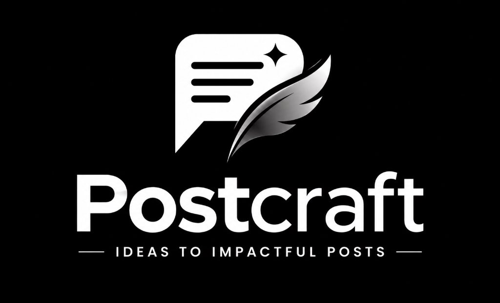
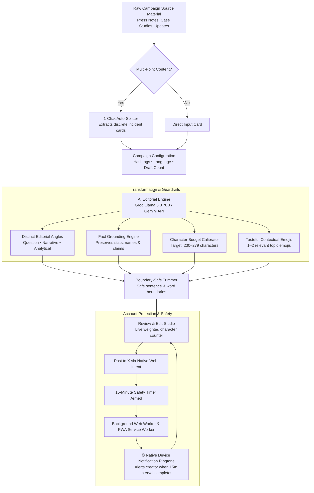

<p align="center">
  
</p>

<h1 align="center">Postcraft</h1>

<p align="center">
  <strong>Intelligent Editorial Drafting Assistant for High-Impact X (Twitter) Campaigns</strong>
</p>

<p align="center">
  
  
  
  
  
  
</p>

---

## 📌 Overview

**Postcraft** is an AI-powered editorial drafting assistant engineered for digital advocacy campaigns, public relations teams, grassroots movements, and social media managers who operate on **X (formerly Twitter)**.

Running a coordinated social media campaign requires publishing numerous posts throughout the day that reinforce a common message while maintaining editorial freshness. However, standard copy-pasting or basic synonym swaps quickly trigger X's duplicate content filters, leading to shadowbans and reduced reach.

Postcraft solves this by taking raw source content (press releases, incident reports, policy updates, or news summaries) and automatically transforming them into a diverse batch of original, fact-grounded drafts—calibrated to Twitter's exact 280-character limit, structured for maximum engagement, and paced to protect accounts from automated spam flags.

---

## 🚨 The Core Problems Postcraft Solves

| Problem | Why It Happens | How Postcraft Solves It |
| :--- | :--- | :--- |
| **Duplicate Content Flags & Shadowbans** | Coordinated accounts posting identical text or simple word swaps are flagged by X's anti-spam heuristics. | Crafts fundamentally distinct drafts using unique editorial angles (question-led, analytical, narrative, principle-driven), varying sentence architecture, and preserving core facts without duplicating phrasing. |
| **The 280-Character Budget Trap** | Maximizing engagement requires filling 230–279 characters while fitting opening hashtags and closing calls-to-action. Manual editing is slow and error-prone. | Enforces a strict 230–279 character floor and ceiling. An intelligent boundary-safe trimmer preserves clean sentence endings and never cuts words mid-sentence. |
| **Multi-Incident Clumping** | Dense notes containing multiple case studies, statistics, or bulleted stories get blurred into a generic overview by standard LLMs. | Includes an intelligent **Auto-Splitter** that detects distinct points, bullets, and incidents, allowing each draft to spotlight an individual story with accurate facts and figures. |
| **Account Suspension from Burst Posting** | Posting multiple tweets in rapid succession triggers bot detection algorithms. | Implements a **15-Minute Safety Cooldown** backed by a mobile PWA Service Worker that rings your device's native notification ringtone when it is safe to post your next draft. |
| **Awkward Multilingual & Hinglish Output** | Conventional models slip into Devanagari script or generate stiff, literal English translations when asked for conversational Hinglish. | Features strict script and tone discipline: produces 100% natural, conversational Hindi written in clean Latin letters (zero Devanagari contamination). |

---

## 🔄 End-to-End Workflow



---

## ✨ Key Capabilities

### 1. Multi-Angle Editorial Engine
Instead of producing superficial variations, Postcraft identifies distinct thematic angles within your source material:
- **Direct Informational:** Clear, authoritative summary of key announcements or facts.
- **Principle & Governance:** Connects specific events to broader societal or humanitarian principles.
- **Narrative & Case Study:** Spotlights a single person, event, or incident with emotional resonance.
- **Question-Led:** Opens with an engaging hook that invites reader reflection.
- **Appreciation & Recognition:** Highlights constructive actions and positive community impact.

### 2. Intelligent Auto-Splitter
Paste long-form press releases, multi-bullet announcements, or numbered situation reports into a single card. Postcraft analyzes line breaks, bullet markers, and paragraph structure to offer an **Auto-Split All** action that cleanly separates individual stories into dedicated source cards.

### 3. Dynamic Post Formatting
Every generated draft respects a clean editorial layout:
```text
#OpeningHashtag
Primary message body drafted with rich context, specific details,
and 1–2 tasteful contextual emojis calibrated to 230–279 chars.
Closing Call-to-Action Line
```
- **Line 1:** Campaign hashtag placed on its own line.
- **Line 2:** Substantive message body with context and descriptive depth.
- **Line 3:** Space-permitting closing handle or URL appended on its own line *only if* the total character budget permits; omitted cleanly if space is tight.

### 4. 15-Minute Safety Cooldown & Native Notification System
- **Anti-Suspension Pacing:** When you dispatch a tweet to X, Postcraft starts a strict 15-minute cooldown timer.
- **Native Notification Ringtone:** Powered by an integrated PWA Service Worker, Postcraft routes reminders through your device's native notification sound stream (`STREAM_NOTIFICATION`), ringing your phone's notification sound—not media/music volume.
- **Post-Initiated Only:** Reminders arm strictly when you initiate a post and disarm immediately once triggered, ensuring zero phantom alarms when browsing drafts.

### 5. Client-Side Privacy & BYOK (Bring Your Own Key)
- User-provided Groq or Gemini API keys are saved exclusively in your browser's encrypted `localStorage`.
- Drafts, source notes, and session histories remain 100% client-side—no backend database tracking your content.

---

## 🛠️ Tech Stack

### Frontend
- **Framework:** React 19 + Vite 6
- **Styling:** Tailwind CSS v4 (monochrome, high-contrast, mobile-first design)
- **Icons:** Lucide React
- **PWA Capabilities:** Standalone Web App Manifest (`manifest.json`), Service Worker (`sw.js`), and Background Timer Worker (`timerWorker.js`)
- **Audio & Haptics:** Native Vibration API & Android Notification Channels

### Backend
- **Framework:** FastAPI (Python 3.10+)
- **Validation:** Pydantic v2
- **AI Integrations:** Groq REST API (Llama 3.3 70B Versatile) with Google GenAI SDK fallback
- **Server:** Uvicorn with ASGI multi-worker support

---

## 📂 Repository Architecture

```text
postcraft/
├── backend/
│   ├── main.py              # FastAPI app, CORS, API routes & static serving
│   ├── ai_service.py        # AI caller, retry logic & boundary-safe character trimmer
│   ├── prompts.py           # Editorial prompt templates, fact-grounding & Hinglish rules
│   ├── schemas.py           # Pydantic v2 request/response contracts
│   ├── requirements.txt     # Python dependencies
│   └── .env.example         # Template for environment variables
├── frontend/
│   ├── public/
│   │   ├── manifest.json    # Standalone PWA web manifest
│   │   ├── sw.js            # PWA Service Worker for native background notifications
│   │   ├── timerWorker.js   # Background worker preventing tab throttle
│   │   ├── logo-banner.jpg  # Main branded banner logo
│   │   ├── logo.png         # Emblem mark logo
│   │   └── favicon.png      # Application icons
│   ├── src/
│   │   ├── components/
│   │   │   ├── ApiKeyPage.jsx      # Standalone API key management page
│   │   │   ├── GeneratedPosts.jsx  # Draft cards, character indicators, cooldown & reminders
│   │   │   ├── Header.jsx          # Mobile-friendly navigation header
│   │   │   ├── IntroSplash.jsx     # Onboarding intro animation
│   │   │   ├── LanguageDropdown.jsx# Language selector (English, Hindi, Hinglish)
│   │   │   ├── SampleCard.jsx      # Source sample card with real-time character count
│   │   │   └── XLogo.jsx           # Vector X (Twitter) glyph
│   │   ├── utils/
│   │   │   ├── reminderService.js  # PWA notification & device vibration manager
│   │   │   ├── storage.js          # LocalStorage persistence & cooldown state
│   │   │   ├── textSplitter.js     # Paragraph & bullet auto-splitter logic
│   │   │   └── twitterCharCount.js # Official weighted X character calculation
│   │   ├── App.jsx                 # Linear editorial workflow container
│   │   ├── index.css               # Design tokens and Tailwind setup
│   │   └── main.jsx                # React root and Service Worker registration
│   ├── package.json
│   └── vite.config.js
├── .gitignore
└── README.md
```

---

## 🚀 Getting Started Locally

### Prerequisites
- **Node.js:** v18.0.0 or higher
- **Python:** v3.10 or higher
- **API Key:** A free API key from [Groq Console](https://console.groq.com/) or [Google AI Studio](https://aistudio.google.com/)

---

### Step 1: Clone Repository
```bash
git clone https://github.com/jmanish45/postcraft.git
cd postcraft
```

---

### Step 2: Backend Setup
```bash
cd backend

# Create virtual environment
python -m venv venv

# Activate virtual environment
# Windows:
.\venv\Scripts\activate
# macOS / Linux:
source venv/bin/activate

# Install dependencies
pip install -r requirements.txt

# Create .env file (optional if providing key via UI)
copy .env.example .env

# Run FastAPI backend
python -m uvicorn main:app --reload --port 8000
```
Backend will be live at `http://localhost:8000` (API documentation at `http://localhost:8000/docs`).

---

### Step 3: Frontend Setup
In a new terminal window:
```bash
cd frontend

# Install dependencies
npm install

# Start Vite development server
npm run dev
```
Open **`http://localhost:5173`** in your browser.

---

## 📱 Mobile PWA Installation

Postcraft is built to function as an installable mobile app:
1. Open the application in **Google Chrome (Android)** or **Safari (iOS)**.
2. Tap the browser menu (`⋮` or Share icon) and select **"Add to Home Screen"** or **"Install App"**.
3. Launch Postcraft directly from your home screen in full-screen standalone mode.
4. Navigate to the **Drafts** tab, enable **15m Reminders**, and tap **Test Alert** to verify your phone's notification ringtone.

---

## 🔒 Security & Privacy Practices

- **Zero-Log Content Policy:** Source samples, generated posts, and configuration parameters are processed in memory and never persisted on the server.
- **Client-Side Key Storage:** Your personal API keys never touch backend logs. They are stored only in your local browser storage and passed directly in the authorization header.
- **Git Protection:** `.env` and all credential files are explicitly excluded in `.gitignore`.

---

## 📄 License

This project is open-source software licensed under the **[MIT License](LICENSE)**.
